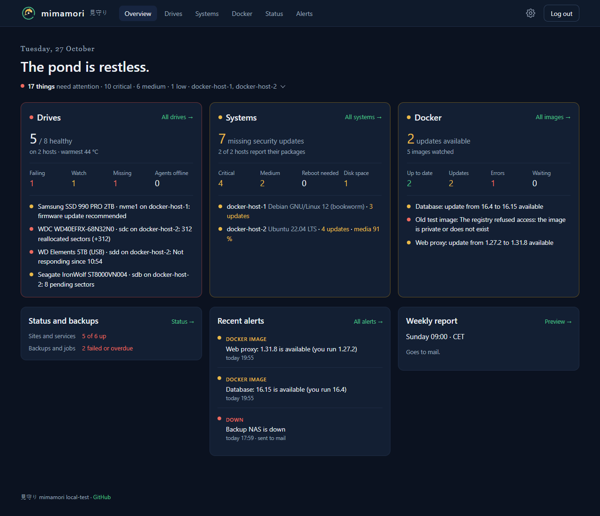
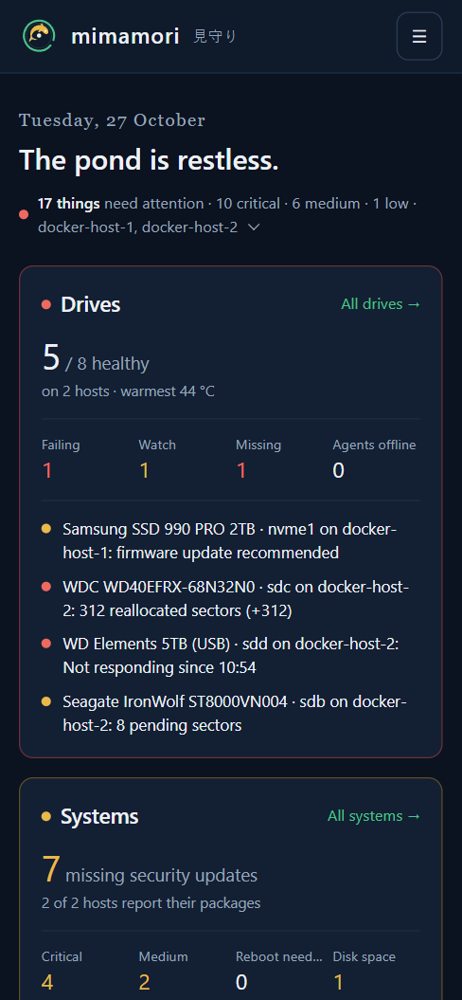

# mimamori 見守り

A self-hosted **drive health monitor**. It watches the SMART data of the drives on all your hosts, keeps their history and tells you when a drive starts to fail, before it takes your data with it. *Mimamori* is Japanese for "watching over".

<br clear="left">

It runs as a server container behind your reverse proxy, plus a small agent container on every host whose drives you want to watch. Each has its own `docker-compose` file.



## Features



- **One page for every host**: status, temperature, power-on hours, wear, reallocated, pending and uncorrectable sectors and CRC errors for each drive, grouped by host
- **History** for every drive: temperature and sector counts over 7 days to a year, the full SMART attribute table with the change over the last week, and its alert log
- **Thresholds you set**: defaults per drive type (hard drive, SATA SSD, NVMe), each overridable per drive; any reallocated, pending or uncorrectable sector marks a drive as *Watch*, a growing count as *Failing*, and a failed SMART self-assessment always counts as *Failing*
- **Notifications** to Discord, mail and your own webhook (signed), when an issue appears, gets worse or is resolved, when a drive disappears and when an agent goes offline; drives can be muted
- **Weekly report** with the state of every drive, by mail and Discord, on the day and time you choose
- **Small agents**: their own image of about 27 MB using about 20 MB of memory. They only connect out, so no port opens on the monitored hosts. Sleeping drives are not woken up for a check
- **Safe agent connection**: every message between agent and server is encrypted, signed in both directions and cannot be replayed; the server keeps only public keys; see [How agents connect](#how-agents-connect)
- **Hardened containers**: the server runs as non-root, read-only, with all capabilities dropped. The agent splits itself in two: only a small part that runs smartctl keeps root, the part that talks to the network runs as `nobody` without any capability; see [Security of the agent](#security-of-the-agent)

The page is plain HTML and CSS served from the container, with no JavaScript. It loads nothing from other servers. The screenshots show made-up drives.

<br clear="right">

## Requirements

- Docker with Docker Compose
- A reverse proxy that terminates HTTPS, for example Nginx Proxy Manager
- On every host with drives to watch: Docker, and the drives visible as `/dev/sd…` or `/dev/nvme…`

## Getting started

There are two parts, each with its own compose file:

| Part | Runs on | Files | Image |
|---|---|---|---|
| Server | one host, behind your reverse proxy | `docker-compose.yml`, `secrets.env` | `ghcr.io/pascal2108/mimamori` |
| Agent | every host with drives to watch, including the server's host if it has some | `docker-compose.agent.yml`, `agent.env` | `ghcr.io/pascal2108/mimamori-agent` |

### 1. Get the files

```bash
git clone https://github.com/Pascal2108/mimamori
cd mimamori
cp secrets.env.example secrets.env
```

### 2. Fill in `secrets.env`

| Variable | Meaning |
|---|---|
| `ADMIN_USER` | User name for the page |
| `ADMIN_PASSWORD` | Password for the page; choose a long one. Shorter than 12 characters works, but the log and the page advise against it |
| `DISCORD_WEBHOOK_URL` | Optional: a Discord channel webhook (Server Settings → Integrations → Webhooks) |
| `SMTP_PASSWORD` | Optional: password of the mail account; the other mail settings are in `docker-compose.yml` |
| `WEBHOOK_URL`, `WEBHOOK_SECRET` | Optional: your own webhook, see [Custom webhook](#custom-webhook) |

`secrets.env` is ignored by git. Never commit it. mimamori refuses to start with the example password.

### 3. Adjust `docker-compose.yml`

The values that depend on your setup have a `# CHANGE` comment at the end of their line:

- **`TZ`**: your time zone, for the times on the page and the weekly report.
- **`networks.proxy.name`**: the Docker network of your reverse proxy. Look it up with `docker network ls`.

The lines that start with `#` and are marked `(optional)` can stay as they are; see [Configuration](#configuration). Leave the block under `Security hardening` unchanged.

### 4. Start the server

```bash
docker compose up -d
docker compose logs -f
```

The log shows `mimamori … started` when the container is ready.

### 5. Add the reverse proxy host

The server publishes no port on the host. It is reachable only inside the Docker network, so all traffic has to come through the proxy.

In Nginx Proxy Manager, add a proxy host:

| Field | Value |
|---|---|
| Scheme | `http` |
| Forward Hostname | `mimamori` |
| Forward Port | `8000` |
| SSL | Request a certificate and enable **Force SSL** |

Put exactly one proxy in front of mimamori. The login lockout relies on the client address reported by that proxy.

### 6. Add an agent

Repeat this for every host with drives to watch.

1. Sign in, open **Settings → Agents**, enter a name for the host and click **Create agent key**. The page shows the key once, together with the files for the host.
2. On the host, put `docker-compose.agent.yml` and `agent.env` into one folder, e.g. by copying them from this repository:

   ```bash
   cp agent.env.example agent.env
   ```

3. In `agent.env`, set `AGENT_KEY` to the key from step 1, and `SERVER_URL` to the HTTPS address of mimamori from step 5:

   ```
   SERVER_URL=https://mimamori.example.com
   AGENT_KEY=…
   ```

4. In `docker-compose.agent.yml`, set `AGENT_NAME` and list every drive of the host under `devices` (`ls /dev/sd? /dev/nvme?` shows them). Both are marked `# CHANGE`. If the host has no NVMe drive, remove the line `- SYS_ADMIN`. Make `agent.env` readable only by root: `chmod 600 agent.env`.
5. Start the agent:

   ```bash
   docker compose -f docker-compose.agent.yml up -d
   docker compose -f docker-compose.agent.yml logs -f
   ```

The log shows `Reported … device(s)`, and the drives appear on the page within a minute. After that the agent checks every hour.

**On the server's own host** the agent can skip the proxy: remove the `#` from the `networks:` lines at the end of `docker-compose.agent.yml` and set `SERVER_URL=http://mimamori:8000`. This is safe, because the messages are encrypted anyway.

### How agents connect

An agent never opens a port; it connects to the server once a minute and sends its report when a check is due. The connection uses public-key cryptography, like SSH:

- **Signed in both directions** (Ed25519). Each agent has its own key pair, and so does the server. The server accepts only messages signed with that agent's private key, and the agent accepts only answers signed by its server, for exactly the request it sent. Nobody can pose as an agent, pose as the server or slip in a fake "check now".
- **Encrypted** (X25519 and AES-256-GCM) with a fresh one-time key for every message, so nobody in between can read a report. A key stolen later cannot decrypt recorded reports or answers either.
- **Not replayable**: each message carries a time stamp that the server accepts only once and only in increasing order. A recorded message is rejected, and so is one from an agent whose clock is more than five minutes off.
- **Only public keys on the server**: the agent's private key exists only in its `AGENT_KEY`, which the page shows once. The server stores just the public key, so even a full copy of the server's data cannot be used to send reports as one of your agents.
- **One key per agent**: **New key** under Settings → Agents replaces it at once; the old key stops working.

This holds over plain HTTP too, which is why an agent may use `http://` inside a Docker network. Over HTTPS through the proxy, TLS adds a second layer on top.

The server's own key pair is created on its first start and kept in its data volume. If that volume is lost, every agent needs a new key.

### Security of the agent

Reading SMART data needs raw access to the drives, which on Linux means root and the capability `SYS_RAWIO` (and `SYS_ADMIN` for NVMe drives). The agent keeps that power as small and as far from the network as it can:

- **Privilege separation**, like OpenSSH: at start the agent splits into two processes. The **collector** keeps root, but only ever runs `smartctl` on the configured drives when asked; it has no network code and accepts a single request, "scan", without parameters. The **reporter** becomes the user `nobody` with **no capabilities at all**, and does everything else: the connection, the cryptography, reading the server's answers. A flaw in that network-facing code gives an attacker an unprivileged process with no access to the drives.
- **No open port**: the agent only connects out, to the one server whose key is in its `AGENT_KEY`. Nothing on the network can talk to it first.
- **The server cannot command it**: the only things an answer can ask for are "check now" and the check interval. There is no way to run commands, change files or choose other devices from the server, even for someone who controls the server.
- **Read-only**: smartctl only reads from the drives (`-a`), and sleeping drives are not woken up. The container's file system is read-only, and only the drives listed under `devices` exist in it.
- **Contained**: every capability is dropped except `SETUID`/`SETGID` (needed once for the split), `SYS_RAWIO` and `SYS_ADMIN`; `no-new-privileges`, memory and process limits, Docker's default seccomp profile.

What remains:

- The collector is root with access to the listed drives. A flaw in smartctl itself, triggered by a manipulated drive, would run with those rights. That needs physical access to the host or a malicious drive.
- `SYS_ADMIN` is a broad capability. Leave it out if the host has no NVMe drive.
- The agent's private key is in `agent.env` on the host. Whoever can read that file can send reports in the agent's name (not more: see above). Keep the file readable only by root (`chmod 600 agent.env`), and create a new key under Settings → Agents if it may have leaked.

### Security of the server

The server is separate from the agents in every respect: it holds no key that lets anyone act as an agent, and an agent can only ever affect its own drives.

- **Hardened container**: non-root, read-only, every capability dropped, `no-new-privileges`, memory and process limits.
- **The page**: one login with a lockout after five failed attempts per address, a session cookie that only travels over HTTPS (`__Host-`, `HttpOnly`, `SameSite=Strict`), a CSRF token on every form, a strict Content Security Policy without any JavaScript, and every value escaped. Without HTTPS the login does not work, unless you allow it with `UNSAFE_HTTP`.
- **Agent messages are hostile input**: every message must carry a valid signature before it is even decrypted; every value from smartctl is type-checked, bounded and truncated. An agent can only change its own drives' data, may send at most one report every 20 seconds, and can trigger at most 20 notifications per hour; more alerts are recorded but not sent, so a compromised host cannot flood your Discord or mailbox.
- **Secrets** stay in `secrets.env` and in memory; the admin password is kept only as a hash. Logs never contain passwords, keys or webhook addresses.

What remains: mimamori has one shared login without two-factor authentication and has not been audited, which is why it belongs into a private network, not on the internet.

## Using it

- **Overview**: every host with its drives. The headline says whether anything needs you. Click a drive for its history.
- **Drive page**: charts for 7 days to a year, the SMART attributes, the alert log, the drive's own thresholds, **Mute alerts** (still recorded, no notifications) and **Forget drive** for drives you removed.
- **Check now** (top right) makes every agent check its drives within a minute. **Send test notification** sends a message to every configured channel.
- **Settings**: agents (rename, new key, remove), the check interval, when an agent counts as offline, the global thresholds and the weekly report schedule.

### What the states mean

| State | When |
|---|---|
| **Healthy** | No threshold reached |
| **Watch** | A warning threshold is reached, e.g. a reallocated or pending sector, or the temperature at its warn limit |
| **Failing** | A critical threshold is reached, e.g. a sector count that grew within the last 7 days, the temperature at its critical limit, or the drive's own SMART self-assessment failed |
| **Missing** | The agent is online, but the drive was not in its last report |

The defaults follow what the numbers usually mean: a few remapped sectors on an old drive can stay stable for years, a count that keeps rising cannot. CRC errors are counted as a cable problem and only warn while they grow. Change the defaults under **Settings → Global thresholds**, or for a single drive on its page.

## Configuration

These are set under `environment:` in `docker-compose.yml`. Only `TZ` needs your value. The others are listed there as comments with their default value:

```yaml
      # RETENTION_DAYS: 400       # (optional) days of history and alerts that are kept
```

To change one, remove the `#` at the start of its line and set the value. The comment behind the value can stay. Then apply it with `docker compose up -d`.

| Variable | Default | Meaning |
|---|---|---|
| `TZ` | `UTC` | Time zone for the page and the weekly report |
| `PUBLIC_URL` | – | HTTPS address of mimamori; used for links in notifications and shown when adding an agent |
| `RETENTION_DAYS` | `400` | How long history and alerts are kept |
| `SESSION_HOURS` | `12` | How long you stay signed in |
| `LOG_LEVEL` | `INFO` | `DEBUG` for more detail |
| `SMTP_HOST`, `SMTP_PORT`, `SMTP_SECURITY`, `SMTP_USER`, `MAIL_FROM`, `MAIL_TO` | – | Mail; `SMTP_SECURITY` is `starttls` (port 587) or `ssl` (port 465). Several recipients are separated by commas |
| `UNSAFE_HTTP` | `false` | ⚠️ **Unsafe.** Login works over plain HTTP; see [Unsafe options](#unsafe-options) |
| `UNSAFE_HTTP_WEBHOOKS` | `false` | ⚠️ **Unsafe.** Discord and webhook addresses may use `http://` |
| `UNSAFE_SMTP_PLAINTEXT` | `false` | ⚠️ **Unsafe.** Allows `SMTP_SECURITY: none` |
| `UNSAFE_HIDE_WARNINGS` | `false` | ⚠️ **Unsafe.** The page no longer shows the notices of the options above |
| `BEHIND_PROXY` | `true` | `false` when mimamori is reached directly through a published port, without a reverse proxy |

The agent is configured in `docker-compose.agent.yml` and `agent.env`:

| Variable | Default | Meaning |
|---|---|---|
| `SERVER_URL` | required | Address of mimamori as the agent's host reaches it: the HTTPS address of the proxy, or `http://mimamori:8000` inside the server's Docker network |
| `AGENT_KEY` | required | The key from Settings → Agents; belongs into `agent.env` |
| `AGENT_NAME` | host name of the container | Name of the host, shown on the page; set it, since the container's own host name is a random ID |
| `DEVICES` | all listed devices | Only check these, e.g. `/dev/sda,/dev/sdb:sat`; after a colon, a `smartctl -d` type for drives behind USB bridges or RAID controllers |
| `LOG_LEVEL` | `INFO` | `DEBUG` for more detail |

### Custom webhook

With `WEBHOOK_URL` set, mimamori sends every alert as a JSON `POST`:

```json
{"kind": "worsened", "label": "Worsened", "level": "crit",
 "title": "Failing · WDC WD40EFRX-68N32N0 · sdc: reallocated 264 → 312",
 "detail": "The drive is remapping or failing to read sectors. …",
 "fields": {"Host": "docker-host-2", "Device": "/dev/sdc", "Temperature": "47 °C"},
 "host": "docker-host-2", "drive": {"device": "/dev/sdc", "model": "…", "serial": "…"},
 "url": "https://mimamori.example.com/drive/3", "ts": 1792270094}
```

`kind` is one of `new_issue`, `worsened`, `resolved`, `missing`, `back`, `agent_offline`, `agent_online`, `report` and `test`; `level` is `crit`, `warn` or `ok`.

With `WEBHOOK_SECRET` set, every request carries the headers `X-Mimamori-Timestamp` and `X-Mimamori-Signature: sha256=<hex>`, the HMAC-SHA256 of `<timestamp>.<raw body>` with the secret as key. Check the signature with a constant-time comparison and reject timestamps older than a few minutes.

### Unsafe options

> [!WARNING]
> These options remove protection. Use them only in a network where you trust **every device and every person**, and never when mimamori can be reached from the internet. While one is on, the container log warns at every start and every page shows a notice that cannot be hidden: a quiet one for a setting, a red one for an unencrypted connection.

**`UNSAFE_HTTP: "true"`** lets the login work over plain HTTP, without a reverse proxy that provides HTTPS. Everything then travels unencrypted: your password, the session cookie and all drive data. Anyone on the same network, such as the Wi-Fi, can read it and take over your session. Over HTTPS the page keeps working as before. Agents are not affected: their messages are encrypted either way.

**`UNSAFE_HTTP_WEBHOOKS: "true"`** allows `http://` addresses for Discord and the custom webhook, for a receiver in your own network without TLS. Alerts then travel unencrypted, and so does a webhook address that contains a token.

**`UNSAFE_SMTP_PLAINTEXT: "true"`** allows `SMTP_SECURITY: none`, for a mail relay in your own network without TLS. Mails, and the SMTP password if one is set, then travel unencrypted.

**`UNSAFE_HIDE_WARNINGS: "true"`** removes the notices that the options above put on every page. It changes nothing about what they do; the people using the page are just no longer told. The container log keeps warning at every start, and says that the page no longer does.

With the normal setup behind a reverse proxy, `UNSAFE_HTTP` alone is enough for a proxy host that is reachable over HTTP; leave `BEHIND_PROXY` as it is. To keep that from happening by accident, switch on **Force SSL** for the proxy host instead: plain HTTP then redirects to HTTPS.

To reach mimamori without a reverse proxy, also publish its port and switch off `BEHIND_PROXY`, so that the login lockout counts real addresses instead of trusting a header that any client could fake:

```yaml
    environment:
      UNSAFE_HTTP: "true"
      BEHIND_PROXY: "false"
    ports:
      - "8000:8000"
```

The page is then at `http://<address of the server>:8000`.

## Troubleshooting

Read the logs with `docker compose logs` on the server and `docker compose -f docker-compose.agent.yml logs` on a host with an agent, or in Portainer.

| Message | Cause |
|---|---|
| Container keeps restarting, log says `ADMIN_PASSWORD …` | `secrets.env` is missing the password, or it is still the example |
| Login works, but the page asks to sign in again | The page was opened over plain HTTP; open it through the HTTPS address of the proxy |
| `Too many failed attempts` | Five wrong logins from one address; wait 15 minutes |
| `502 Bad Gateway` from the proxy | The container is not running, or the forward hostname or network is wrong |
| Agent: `SERVER_URL and AGENT_KEY must be set` | `agent.env` is empty; create a key under Settings → Agents |
| Agent: `the server did not accept AGENT_KEY` | The key is wrong, or a new one was created; copy the current one into `agent.env` |
| Agent: `the clocks of this host and the server differ` | Set up time synchronisation (NTP) on both hosts |
| Agent: `the answer is not from the mimamori server that owns this AGENT_KEY` | `SERVER_URL` points to another server, or something in between changed the answer |
| Agent: `The server's certificate is not trusted` | `SERVER_URL` points to an address whose certificate is self-signed or for another name; use the proxy's address with a valid certificate |
| Agent: `Cannot reach the server` | `SERVER_URL` is wrong or not reachable from the agent's host |
| A drive is missing on the page | It is not listed under `devices` of its agent, or the agent cannot open it; drives behind USB bridges may need a type in `DEVICES`, e.g. `/dev/sdb:sat` |
| A card says `no SMART data from this device` | The drive or its controller does not pass SMART through, e.g. a virtual disk or some USB enclosures |
| Agent shows as offline | No heartbeat for 10 minutes; check the agent's log and that its host is running |

## Updating

```bash
docker compose pull && docker compose up -d
```

On a host with an agent:

```bash
docker compose -f docker-compose.agent.yml pull && docker compose -f docker-compose.agent.yml up -d
```

New images are published on every push to `main` and once a week, so that security updates of the base image and the libraries are included. Tools such as Watchtower pick them up automatically. Server and agents of the same version belong together; update both.

### Versions

Both images are published under these tags. Set the one you want in the `image:` line of `docker-compose.yml` and `docker-compose.agent.yml`.

| Tag | Contains | Changes |
|---|---|---|
| `latest` | The current stable version | With every release, and weekly for security updates |
| `0`, `1`, … | The newest stable version within that major version | With every release of that major version, and weekly for security updates |
| `0.1.0`, `0.2.0`, … | Exactly that [release](https://github.com/Pascal2108/mimamori/releases) | Never; it also receives no security updates |
| `beta` | What is being tested for the next release | Often; it may break |
| `0.1.1-beta.1`, … | Exactly that test version ([pre-release](https://github.com/Pascal2108/mimamori/releases)) | Never |

Use `latest` unless you have a reason not to. A version number is for going back when an update causes trouble: the release notes say what changed and whether you have to adjust your `docker-compose.yml`.

### Server and agents are updated separately

The server is backwards compatible with older agents: **every newer server works with every agent that was released before it.** So you can keep the server on `latest` to get every improvement of the page, and update the agents on your hosts only when you choose to.

This works because the agent only collects: it sends smartctl's full output, and the server does all the interpreting. A newer server can read more from the same data, so even an old agent benefits from it. New features never require a newer agent; at most they appear only when the agent is updated too, and the release notes say so.

**Recommended:** keep the server on `latest`, and update the agents by hand when you choose to. Docker only fetches a new agent image when you run `docker compose -f docker-compose.agent.yml pull`, so an agent never changes on its own (unless a tool such as Watchtower does it for you). Before updating an agent, read the release notes: a new agent version may need a change in `docker-compose.agent.yml`, for example a new capability. The server never needs that: it keeps working with the agents you have not updated yet.

`docker-compose.agent.yml` uses `ghcr.io/pascal2108/mimamori-agent:0`, the newest version of major version 0, which also receives the weekly security updates. To freeze an agent at one version, use it exactly, e.g. `mimamori-agent:0.1.0`.

The other way round is not promised: an agent newer than its server may use features the server does not know yet. Update the server first.

## Questions and feature requests

Open an [issue on GitHub](https://github.com/Pascal2108/mimamori/issues/new/choose) (a free account is needed) and choose **Bug report** or **Feature request**; for a question, open a blank issue. Issues are public, so leave out agent keys, passwords, host names and serial numbers.

Found a security problem? Please do not open an issue; report it privately as described in [SECURITY.md](SECURITY.md).

## Legal

This section is information from the author, not legal advice.

### Not for the public internet

mimamori is built for private use inside a network you control: a home network or a VPN such as Tailscale or WireGuard. It is **not meant to be reachable from the public internet**. It has one shared login, no user management and no two-factor authentication, and it has not been audited by anyone. Do not publish its port, do not forward a port to it, and do not put it behind a proxy that is open to the internet.

### License

mimamori is free software under the [GNU Affero General Public License, version 3](LICENSE) (AGPL-3.0).
Copyright (C) 2026 Pascal2108.

- You may use, study, change and share it.
- If you share it, changed or not, you have to pass on the same rights: keep the license and the copyright notice, and make the source code available.
- This also applies if you change it and let other people use your version over a network, without handing them a copy. They are entitled to the source code of your version.

The images also contain other software under its own licenses, among them smartmontools (GPL-2.0) in the agent image, which the agent runs as a separate program.

### No warranty, no liability

mimamori is a private project, provided as it is and without warranty of any kind, as sections 15 and 16 of the license state. You run it at your own risk. It can only report what the drives themselves report: many drives fail without warning in their SMART data, so **mimamori is no replacement for backups**. To the extent the law permits, the author is not liable for damage, data loss, missed or false alerts, or any other consequence of installing, running or misconfiguring it. You are responsible for securing your server, for keeping it updated and for backing up your data.

### Cookies and personal data

- **One cookie:** mimamori sets a single cookie, `__Host-mimamori`, when you sign in. It holds your signed-in session, lasts for `SESSION_HOURS`, and is removed when you sign out. Without it the login cannot work.
- **No tracking:** there are no analytics, advertising or third-party cookies, and the page loads nothing from other servers.
- **Consent:** a cookie that is strictly necessary for a service the user asked for generally needs no consent banner under the EU ePrivacy rules (in Germany § 25 TDDDG). This fits a login cookie, but the assessment for your own installation is yours.
- **Personal data:** the container log records the address of each device that signs in or fails to. The database holds drive data (models, serial numbers, SMART values), the names you give to hosts and the agents' public keys. Notifications are sent only to the channels you configure.

If other people use your installation, you are its operator: informing them and complying with data protection law, such as the GDPR, is your responsibility.
