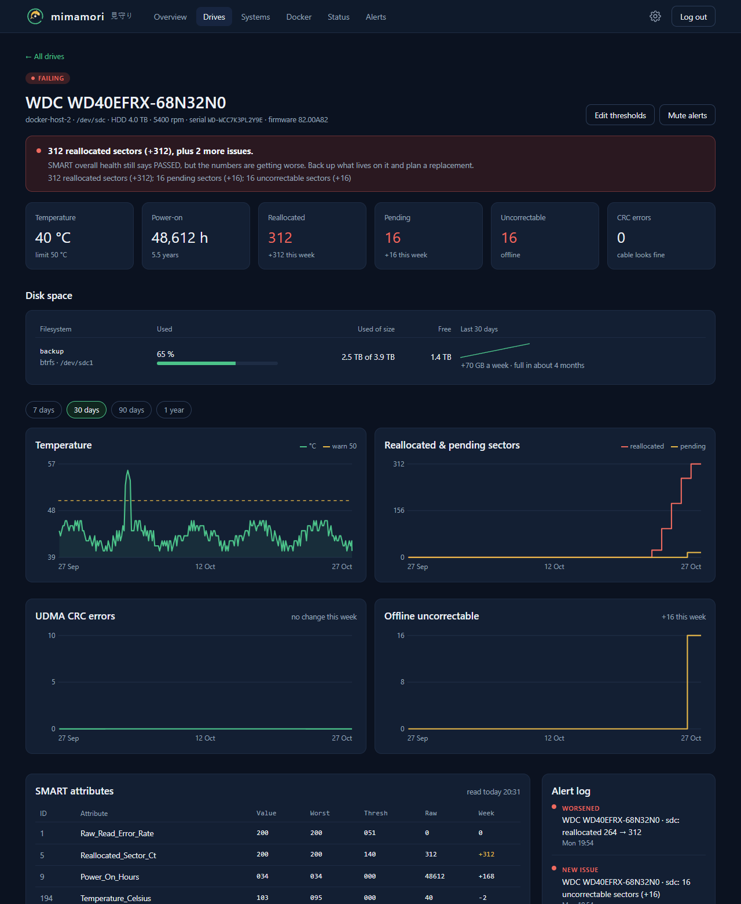
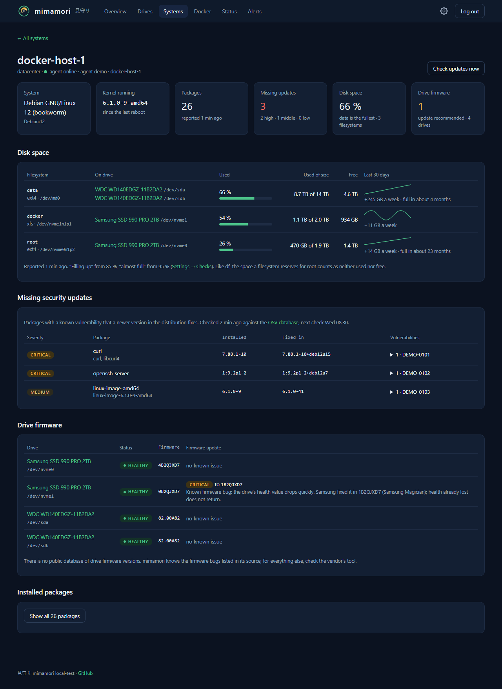
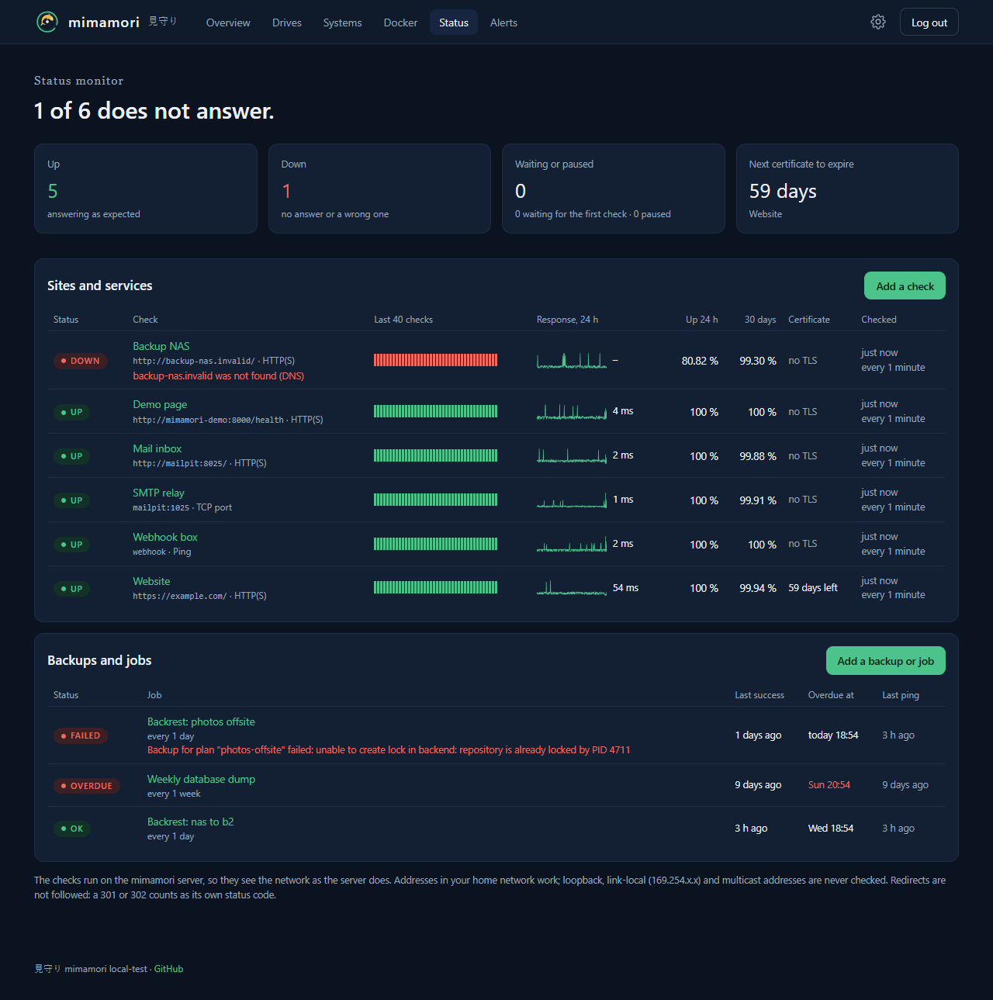
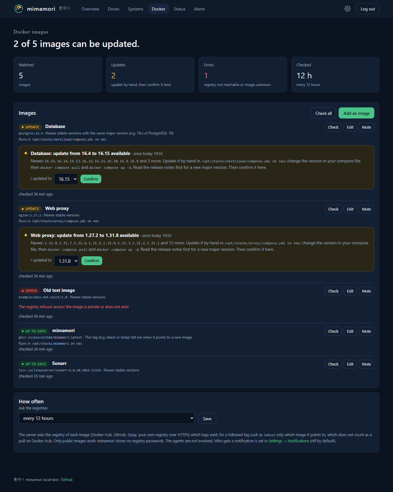

# mimamori 見守り

A self-hosted **monitor for your hosts and services**. One page shows what needs you: failing drives, missing security updates, full disks, websites that stop answering, backups that failed or did not run, and Docker images with a newer version. *Mimamori* is Japanese for "watching over".

<br clear="left">

> **Beta:** every version below 1.0 is a beta. mimamori works and is used every day, but settings and pages may still change between versions. Read the release notes before you update.

A server container runs behind your reverse proxy. A small agent container on each host reports its drives, packages and disk space. Status checks, backups and Docker images need no agent: the server checks them itself, or the job reports to it.


## What it watches


- **Drives**: SMART data of every drive on every host, with temperature, power-on hours, wear and sector counts, a history of up to a year and thresholds you set per drive type or per drive. A reallocated or pending sector means *Watch*, a growing count *Failing*
- **Systems**: missing security updates of Debian, Ubuntu and Alpine hosts, a pending reboot after a kernel update, drive firmware with a known bug ([details](docs/updates.md)), and how full each filesystem is, with a trend and a warning before it is full
- **Sites and services**: the server checks websites (HTTP and HTTPS, with their certificate), TCP ports and hosts by ping, and tells you when one stops answering or a certificate is about to expire
- **Backups and jobs**: Backrest, cron jobs and scripts report each run to a secret URL; mimamori tells you when one fails or does not run in time
- **Docker images**: the server asks Docker Hub, GHCR and other registries whether a newer version of the images you run exists. You update by hand and confirm on the page
- **Notifications** to Discord, mail and your own webhook, chosen per channel and topic, plus a weekly report
- **Read-only API** for dashboards and scripts, and a [Home Assistant integration](https://github.com/Pascal2108/mimamori-homeassistant) ([API](docs/api.md))
- **Small, safe agents**: about 30 MB of memory and next to no CPU, no open port, end-to-end encrypted, the network part runs without any privilege ([details](SECURITY.md#how-mimamori-is-secured))
- **No JavaScript, nothing loaded from other servers**

<br clear="right">

| | |
|---|---|
|  |  |
| **A drive**: history, SMART table, thresholds | **A host**: disk space, security updates, firmware |
|  |  |
| **Status**: sites, services, backups and jobs | **Docker**: images with a newer version |

The screenshots show made-up hosts, drives and updates.

## Getting started

You need Docker with Docker Compose and a reverse proxy that provides HTTPS (e.g. Nginx Proxy Manager). For the drives of a host, they must be visible to it as `/dev/sd…` or `/dev/nvme…`.

### 1. Server

```bash
git clone https://github.com/Pascal2108/mimamori
cd mimamori
cp secrets.env.example secrets.env
```

1. In `secrets.env`, set `ADMIN_USER` and a long `ADMIN_PASSWORD`. Optionally add a Discord webhook or mail password ([all settings](docs/configuration.md)). Never commit this file.
2. In `docker-compose.yml`, set the two values marked `# CHANGE`: your time zone `TZ` and the Docker network of your reverse proxy (`docker network ls`).
3. Start it: `docker compose up -d`. The log (`docker compose logs -f`) shows `mimamori … started`.
4. In your reverse proxy, add a host that forwards to `http://mimamori:8000`, with a certificate and **Force SSL**. The server publishes no port of its own, so all traffic goes through the proxy. Use exactly one proxy: the login lockout relies on the address it reports.

Status checks, backups and Docker images work from here on. Add them on the **Status** and **Docker** pages ([see below](#using-it)).

### 2. Agents

On every host to watch, including the server's host:

1. On the page, open **Settings → Agents**, enter the host's name and click **Create agent key**. The key is shown only once.
2. Copy `docker-compose.agent.yml` and `agent.env.example` to the host, rename the latter to `agent.env` and fill in `SERVER_URL` (the HTTPS address of mimamori) and `AGENT_KEY`. Then `chmod 600 agent.env`.
3. In `docker-compose.agent.yml`, set `AGENT_NAME` and list the drives under `devices` (`ls /dev/sd? /dev/nvme?`), each as `/dev/sdb:/dev/sdb:r`, so the container can only read them. Without NVMe drives, remove the line `- SYS_ADMIN`.
4. Start it: `docker compose -f docker-compose.agent.yml up -d`. The log shows `Reported … device(s)`, and the host appears on the page within a minute.

**Security updates (optional):** remove the `#` in front of the host's package list lines under `volumes:` in `docker-compose.agent.yml`, recreate the agent, and turn the check on under **Settings → Updates** ([details](docs/updates.md)).

**Disk space (optional):** create an empty folder on each filesystem (e.g. `mkdir /srv/mimamori-fs`) and mount it read-only under `/host/fs/<name>`, as shown under `volumes:` in `docker-compose.agent.yml`. The agent only asks how full the filesystem under the folder is; it cannot read a single file of the host this way. This needs agent 0.3.2 or newer.

## Using it

The **overview** sums up drives, systems, Docker images, status checks and backups. Everything that needs you is ranked as critical, medium or low, and the headline follows the worst of it. **Check now** on the Drives page makes every agent report within a minute.

### Drives

**Drives** lists every drive by host. Click one for its history, SMART table and thresholds.

| State | When |
|---|---|
| **Healthy** | No threshold reached |
| **Watch** | A warning threshold is reached, e.g. a reallocated or pending sector, or the temperature at its warn limit |
| **Failing** | A critical threshold is reached, e.g. a sector count that grew within the last 7 days, or the drive's own SMART self-assessment failed |
| **Missing** | The agent is online, but the drive was not in its last report |

A few remapped sectors on an old drive can stay stable for years, a count that keeps rising cannot. That is why only growth counts as Failing.

### Systems

**Systems** shows every host with its operating system, missing security updates, a pending reboot and how full its filesystems are. Click a host for its packages, the updates it misses, the firmware of its drives and the trend of its disk space. A filesystem counts as filling up from 85 % and as almost full from 95 %.

### Sites and services

**Status** lists the websites and services the server checks itself. Add one with **Add a check** and choose what to check:

| Check | What counts as up |
|---|---|
| **HTTP(S)** | The URL answers with one of the expected status codes (200-399 by default). Over `https://` the certificate can be verified, with a warning a chosen number of days before it expires; turn the verification off for a self-signed certificate |
| **TCP port** | The port accepts a connection, optionally with a TLS handshake and a verified certificate (e.g. IMAPS, SMTPS) |
| **Ping** | The host answers an ICMP echo request |

A check counts as down after a number of failed checks in a row (2 by default), so one lost packet does not wake you up. Who gets told about down, back up and expiring certificates is chosen in **Settings → Notifications**, like everything else. The checks run on the server and see the network as it does: addresses in your home network work, loopback, link-local (`169.254.x.x`, cloud metadata) and multicast addresses are never checked, and redirects are not followed.

### Backups and jobs

**Backups and jobs**, also on the Status page, are the other way round: the job reports to mimamori. Add one with **Add a backup or job**, say how often it runs and how late it may be, and copy the secret URL that is shown once. The job then sends a POST to it, in the same way as for healthchecks.io:

| Request | Means |
|---|---|
| `POST <url>` or `<url>/0` | the run succeeded |
| `POST <url>/start` | a run began |
| `POST <url>/fail` or `<url>/<exit code>` | the run failed |
| `POST <url>/log` | a note, changes nothing |

For **Backrest**, add a hook of the type *Healthchecks* to the plan with this URL, for the conditions `CONDITION_SNAPSHOT_START`, `CONDITION_SNAPSHOT_SUCCESS` and `CONDITION_SNAPSHOT_ERROR`. For a script: `curl -fsS -m 10 --retry 3 -X POST <url>/$?` at its end. A failure is reported at once, a missing success once the interval plus the allowed delay has passed since the last one, which also catches a job that never started. The text in the request body (e.g. Backrest's summary) shows up on the page and in the alert.

### Docker images

**Docker** lists the images your containers run. Add one with **Add an image**: the image as in your compose file (`nginx`, `linuxserver/sonarr`, `ghcr.io/owner/app`), the version you run, and what counts as an update:

| Choice | Example | You are told about |
|---|---|---|
| **Newer stable versions** | `1.27.2` | `1.27.3`, `1.28.0`, `2.0.0` |
| **Same major version** | `16.4` (PostgreSQL) | `16.5`, but not `17.0`, which needs a migration |
| **Betas included** | `0.3.2` | `0.3.3-beta.1` as well |
| **This tag** | `latest`, `beta` | the tag pointing to a new image (e.g. a rebuild with security fixes) |

Only tags of the same form count: after `1.27.2-alpine` comes `1.27.3-alpine`. A new version shows up on the overview (and, if you turn it on under **Settings → Notifications**, in your channels). Update the container by hand, e.g. `docker compose pull && docker compose up -d`, then click **Confirm** with the version you now run. The server asks the registries every 12 hours by default, or only when you click **Check**. It never changes anything on your hosts, and the agents are not involved. Only public images work: mimamori stores no registry passwords.

### API and Home Assistant

Under **Settings → API tokens** you create tokens for the read-only API. It returns in one answer what the overview shows, for dashboards, scripts and the [Home Assistant integration](https://github.com/Pascal2108/mimamori-homeassistant). Nothing can be changed through it. See [API](docs/api.md).

If something does not work, see [Troubleshooting](docs/troubleshooting.md).

## Updating

```bash
docker compose pull && docker compose up -d                                                  # server
docker compose -f docker-compose.agent.yml pull && docker compose -f docker-compose.agent.yml up -d   # agent
```

Every newer server works with every older agent, so keep the server on `latest` and update the agents when you choose to, after reading the release notes. More on [versions and tags](docs/updating.md).

## Unsafe options

> [!WARNING]
> mimamori has options that remove protection, named `UNSAFE_…`: login over plain HTTP, webhooks over `http://`, mail without TLS, and hiding the warnings about them. They are off by default. Use them only in a network where you trust every device and every person. While one is on, the log and every page warn about it. Read [Unsafe options](docs/configuration.md#unsafe-options) before you turn one on.

## Not for the public internet

mimamori is built for a network you control, such as your home network or a VPN (Tailscale, WireGuard). It has one shared login without two-factor authentication and has not been audited, so do not make it reachable from the internet. It is no replacement for backups either: many drives fail without warning in their SMART data.

## More

- [Security](SECURITY.md#how-mimamori-is-secured): how agents connect, and how agent and server are protected
- [Configuration](docs/configuration.md): all settings, the custom webhook and the unsafe options
- [Missing updates](docs/updates.md), [Troubleshooting](docs/troubleshooting.md), [Updating](docs/updating.md)
- [API](docs/api.md): the read-only API for Home Assistant and your own scripts
- Questions and ideas: open an [issue](https://github.com/Pascal2108/mimamori/issues/new/choose), without keys, passwords, host names or serial numbers. Security problems go privately, see [SECURITY.md](SECURITY.md)

Free software under the [AGPL-3.0](LICENSE), without warranty. License, liability, cookies and personal data: [Legal](docs/legal.md).
